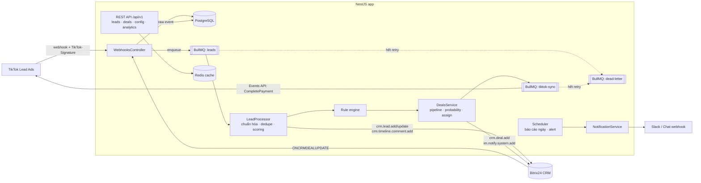
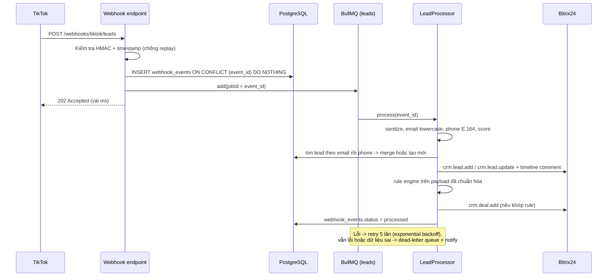
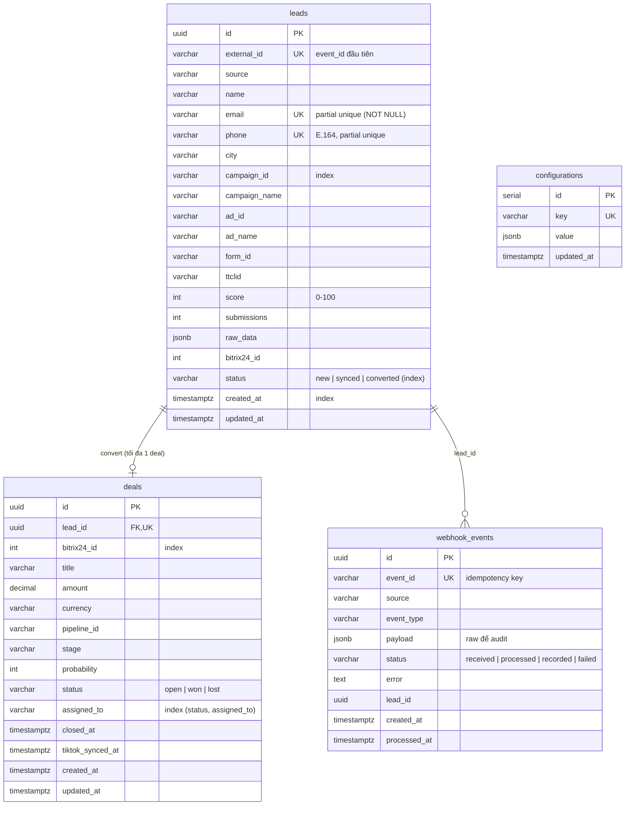

# Kiến trúc

## Tổng quan

## Luồng xử lý một lead

## Module

| Module | Trách nhiệm |
| --- | --- |
| `webhooks` | Endpoint nhận webhook TikTok/Bitrix24, guard xác thực chữ ký/token |
| `leads` | Lưu raw event, queue processor, chuẩn hóa, dedupe/merge, đồng bộ Bitrix24, list/import API |
| `deals` | Rule engine, tạo deal, round-robin assign, sync stage từ Bitrix24, gửi conversion về TikTok |
| `settings` | Cấu hình runtime (field mapping, rules, pipeline stages, chi phí campaign) trong DB + cache Redis |
| `analytics` | Conversion rate, CPL/ROI, dashboard, export CSV/JSON, báo cáo định kỳ & alert |
| `jobs` | Đăng ký queue, dead-letter queue và API retry |
| `integrations` | Client Bitrix24 (live REST / mock in-memory) và TikTok Events API (live / mock) |
| `common` | Redis, cache, notification, API-key guard, exception filter, logging interceptor |
| `health` | `/health` (DB + Redis) và `/health/live` |

## Database ERD

### Index và lý do

- `uq_leads_email`, `uq_leads_phone` (partial unique): vừa tăng tốc tra cứu dedupe, vừa chặn tạo trùng khi 2 job xử lý cùng một người song song. Job "thua" sẽ lỗi unique, BullMQ retry và lần sau sẽ merge.
- `webhook_events.event_id` unique: idempotency, TikTok gửi lại cùng event thì không xử lý 2 lần.
- `deals.lead_id` unique: mỗi lead tối đa 1 deal, convert lặp lại an toàn.
- `leads(campaign_id)`, `leads(created_at)`: phục vụ báo cáo theo campaign và khoảng thời gian.
- `deals(status, assigned_to)`: khớp với filter của `GET /api/v1/deals?status=&assigned_to=`.
- `deals(bitrix24_id)`: tra cứu khi nhận webhook từ Bitrix24.

Schema giữ nguyên các cột của đề bài, chỉ thêm cột cần cho tính năng (`score`, `submissions`, `status` của deal, `tiktok_synced_at`...) và bảng `webhook_events` để audit.
